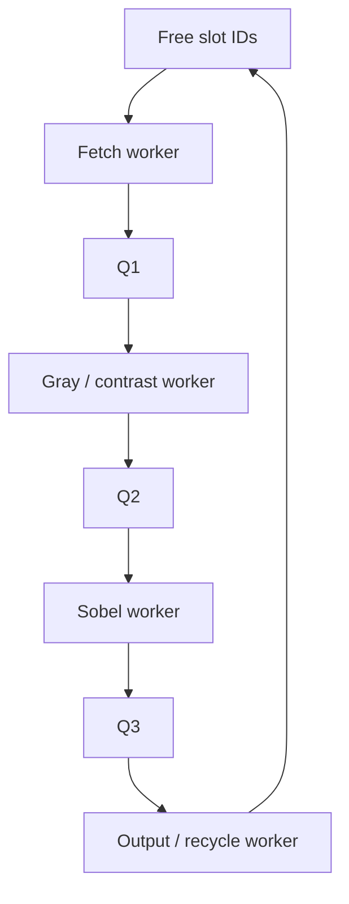

# Implementation contract and measurement methodology

CPU-only C++20 preprocessing. See SOURCE_ALIGNMENT.md for the selected sources and architectural choices.

## One deterministic operation chain: source profile (default)

1. **Fetch:** read one decoded RGB8 frame into its slot and assign a replay ID. Dynamic allocation occurs within Fetch service time.
2. **Gray/contrast:** weighted RGB grayscale followed by fixed affine contrast.
3. **Edges:** absolute vertical Sobel response, binary threshold, then morphological closing (dilation followed by erosion). All three operations belong to the same worker and `sobel_ms` measurement.
4. **Output/recycle:** copy the final edge map, fingerprint all pixels, optionally capture edge and grayscale bytes, release dynamic arrays and recycle the slot.

```text
Y = floor((299*R + 587*G + 114*B + 500) / 1000)
C = clamp(floor((5*Y+2)/4)-32, 0, 255)
Gx = [-1 0 1; -2 0 2; -1 0 1] applied to C
binary = 255 if abs(Gx) >= threshold, else 0
closed = erode_3x3(dilate_3x3(binary))
```

Default threshold is 80 in raw Sobel-response units (0..1020). It has not been optimized for recognition. The structuring element is a full 3×3 square. Signed arithmetic prevents gradient underflow. The Sobel outer border is zero. Dilation treats out-of-image pixels as zero; erosion also uses zero outside, so the final one-pixel border is zero. No histogram equalization, Gaussian blur, HSV mask or image resizing is hidden inside these operators.

Closing reuses the first WH bytes of the slot's consumed RGB buffer as dilation scratch. Fetch overwrites the full RGB buffer when that slot is reused. Grayscale is preserved. This requires no fourth frame array. Demo input PNGs are read from the original replay after the run; they are not read from the reused scratch. Queues transfer only a slot ID and do not copy its pixel arrays.

A–E use row traversal; F uses column traversal for grayscale, Sobel, dilation and erosion. This can affect prefetching, cache behavior, auto-vectorization and loop overhead. F is a traversal control, not direct evidence of a cache-miss cause.

## Legacy profile (explicit opt-in)

`--profile legacy` preserves the first archive's workload: weighted grayscale, `clamp(floor((5*Y+2)/4)-32,0,255)` affine contrast, both standard Sobel gradients, then `min(255,abs(Gx)+abs(Gy))`. It ignores the edge threshold, records `edge_threshold=-1`, and is a separate algorithm configuration. It uses the same zero border and traversal controls. Historical results for this profile must not be used as timings for the revised source profile.

The source profile implements neither a saliency map nor candidate-plate extraction, segmentation or OCR. It is a preprocessing subset, not a full reproduction of either reference system.

## Sequential baselines

`edge_seq` completes all four stages for frame i before starting frame i+1. It creates no worker threads. A allocates three arrays for each frame and frees them in Output. B allocates three arrays once before timing and reuses them. Both use the same persistent output buffer, input reader, frame records, fingerprints and image kernels as the pipeline.

The source is not deliberately slowed, and no artificial delay is added in unpaced mode. The output work is retained so that both executables perform the same observable computation. Output-buffer copying and full-frame fingerprinting have a measured cost; Output can itself become the longest stage.

## Four-worker pipeline and ownership

Four `std::thread` workers implement Fetch, Gray/Contrast, Sobel, and Output/Recycle. The coordinator releases a common start gate and waits for completion. Workers overlap **different frames**. A thread is not pinned to a core; OS scheduling decides placement.

The `thread_id` in workers.csv identifies the actual C++ thread; sequential rows share one ID, pipeline rows identify four workers. It is not a core number or an OS profiler event.

Each slot owns three independent arrays: RGB (3WH bytes), grayscale (WH), and edges (WH). Bounded FIFO rings store only slot IDs, avoiding full-frame image duplication between stages. A mutex establishes synchronization and ownership transfer. The pipeline is copy-avoiding at queue boundaries; it is not zero-copy overall.

Ownership sequence:



A worker retains its slot while its downstream queue is full. Consumers wait when their input is empty. Full/empty waits use condition variables rather than busy spinning. The bounded ring itself is allocated once and performs no per-item heap allocation. C keeps bounded slot descriptors but allocates/free pixel arrays per frame; D/E/F allocate the arrays beforehand and reuse them.

Normal termination closes Q1 after the producer's last frame, drains Q1, closes Q2, drains Q2, closes Q3, and drains Q3. A captured worker exception cancels the run, closes every queue, wakes paced producers, joins started threads and returns failure. No success marker is published for an incomplete run.

## Memory policy

Default pipeline slot count is **34** in every configuration and every 2/5/10 queue test. This accommodates the largest intended topology: three queues of capacity 10 plus at most one slot held by each of four workers. Smaller queues may leave more free slots unused. Do not change `--slots` while attributing a comparison solely to queue capacity.

Frame storage bound, excluding source preload, logs, stack, allocator overhead and runtime:

```text
frame storage = slots * (3WH + WH + WH) + WH
              = (5*slots + 1) * W * H bytes
```

At 1920×1080, B's one slot plus output uses 12,441,600 bytes (~11.9 MiB). The default pipeline reserves up to 354,585,600 bytes (~338.2 MiB). Physical residency depends on which arrays/pages are touched. C has the same upper bound but keeps pixel arrays only for active frames. A pool can reduce allocation churn while increasing retained storage; it is not guaranteed to reduce peak RSS.

`new uint8_t[n]` leaves pixels uninitialized; all valid pixels are written before use. There is no explicit pretouch of the pool. Initial page touching can therefore occur during timing in both allocation modes. Pooled allocation itself is outside timing and is represented by `setup_s` and setup allocation counts.

`timed_frame_array_allocations` counts successful-run calls attributable to the three frame arrays: exactly 3N for dynamic and 0 for pooled operation. `setup_frame_array_allocations` includes the one output buffer and pooled frame arrays. These are deterministic counts of this code's large-array allocations, **not instrumentation of every C++/OS allocation**. They exclude metadata, threads, queues, CSV writers, input buffers and optional capture memory. Do not report them as total allocator calls.

Per-frame timing records are preallocated before timing and grow with N. A guard caps the requested frame buffers, capture and records at 2 GiB, with combined capture separately capped at 512 MiB (three planes for source: final edges, grayscale and pre-closing binary; two for legacy). Optional source preload adds at most 1 GiB. This guard does not predict the complete process's physical memory use.

## Input preparation and IO controls

`prepare_data.py` converts authorized images once to uncompressed RGB or generates explicitly synthetic patterns. All frames in a replay share dimensions. It writes a manifest with source selection, conversion details, file length and SHA-256. `benchmark.py` checks the hash before and after the experiment.

`--io file`: each Fetch reads a frame from the replay file. This includes user-space file operations and whatever storage/cache behavior the OS supplies. A warm file-cache read is not a physical SSD read. Results must not be presented as measured SSD bandwidth.

`--io ram`: load the entire replay before timing, then copy each frame into the same per-slot RGB buffer. This removes timed file reads but preserves a real input copy. RAM source reads remain part of the memory workload. Source preload is limited to 1 GiB, so full UFPR replay uses file mode.

Neither mode measures PNG decoding, video decoding, capture, network transport or GUI display. Raw preprocessing isolates the agreed architecture mechanisms but narrows the end-to-end application claim. A large decoded collection may exceed available memory. Use file mode for large collections; RAM mode has a 1 GiB source-preload guard.

## Timer boundaries

All wall timestamps use `std::chrono::steady_clock`. The elapsed timer starts after input validation, allocation of pooled arrays/output/records, optional RAM preload, and thread creation. Workers wait at the start gate. The timer stops after all frames finish and pipeline workers join. Sequential mode has no worker startup/join.

Included: frame reads/copies, dynamic allocation/free, image kernels, output copy and fingerprints, timestamp calls, frame-record writes, queue locking and condition-variable waits, pipeline fill/drain, paced waiting and OS scheduling delays. Excluded: preparation/decoding, executable startup, setup, CSV/JSON writing and GUI work. End-to-end process execution is consequently longer than `elapsed_s`; report `setup_s` separately when startup matters.

The separate-process warmup warms some source/code/system state. It does not preserve the measured process's heap, thread state or private buffer pages. With a dataset larger than RAM, it does not guarantee every input byte remains cached. Initial fill/drain is retained in primary FPS. `steady_output_fps` is a secondary estimate between completions near the 10th and 90th percentiles of frame order; it omits outer regions and is unavailable for N≤20.

Each frame records:

| Field | Meaning |
|:---|:---|
| `request_ms` | Producer ready to acquire a slot, after paced waiting |
| `admit_ms` | Slot obtained; Fetch service begins before dynamic array allocation/read |
| `done_ms` | Output copy/fingerprint and dynamic array release finished |
| `latency_ms` | done − admit, including inter-stage blocking/residence after admission |
| `request_latency_ms` | done − request, additionally including pre-admission slot wait |
| `scheduled_ms` | Virtual source time i/rate in paced mode; admit time when unpaced |
| `source_latency_ms` | done − scheduled; meaningful as source delay in paced mode |
| `admission_lag_ms` | admit − scheduled; virtual-source backlog indicator in paced mode |
| `pool_wait_ms` | admit − request; acquisition overhead plus any free-slot wait |
| `fetch/gray/sobel/output_ms` | Wall service interval for the corresponding stage |
| `slot_id` | Actual buffer slot used for this frame; reuse is checked by the demo |
| stage begin/end fields | Wall timestamps for inspecting frame overlap and delays |

Service time includes pre-emption while a stage is active; it is not CPU instruction execution time. In particular, a longer Sobel wall interval in a pipeline can reflect scheduling or memory contention. Worker CPU time is measured separately over the worker's run.

## Queue, CPU and memory measurements

- Queue mean occupancy is the time integral of queue depth divided by the full measured elapsed interval. High-water marks are measured at push operations. These are not sampled averages or queue-residence-time estimates. `free_pool` is reported separately; high free-pool occupancy means few buffers are in use.
- `cv_input_wait_s` and `cv_output_wait_s` record condition-variable wait intervals, including reacquisition after wake. They exclude uncontended queue calls and initial mutex-acquisition time. `cv_stall_pct` is their sum / elapsed ×100. It is a partial synchronization metric, not all blocked CPU time. Full/empty wait events count calls that found a full/empty queue, not every spurious wake.
- Worker CPU time uses Windows `GetThreadTimes` or Linux thread CPU clocks. One-core CPU percentage = worker CPU seconds / elapsed ×100. Windows accounting granularity makes short runs unreliable; a measured zero is possible on very short workers.
- Process CPU time is measured over the timed interval. Process one-core percentage can exceed 100% because threads run concurrently. Divide by reported logical CPU count only if you need a machine-normalized percentage, and label that convention.
- Sequential stage service times are reported, but per-stage worker CPU fields are empty because one thread performs all four stages. The process CPU figure represents its measured execution.
- Peak process memory is Windows `PeakWorkingSetSize` or Linux peak RSS from `getrusage`. It is a process-lifetime high-water mark read after timing, including setup/preload/records. It is not the frame pool's exact size, a heap-only count, or a sampled timed-region peak.
- IPC, instructions, cycles, cache events, bandwidth, energy, per-core utilization history and context switches are **not collected by this program**. `hardware_counters` is null. The external-profiler procedure is in the comparison guide. Do not fill absent events with zero or derive them from FPS.

## Paced replay and backpressure

`--rate 0` supplies frames as fast as the program permits. For rate r>0, frame i has a virtual release time `start + i/r`. A condition-variable timed wait pauses early producers and wakes on cancellation. If execution falls behind, the producer does not sleep and attempts the next frame as soon as ownership allows.

The selected policy is **block, preserve order, never drop**. An overloaded producer therefore accumulates delay against the virtual input schedule. Internal queues stay bounded, but this does not bound virtual-source delay. `dropped_frames=0` is a consequence of this policy, not evidence that a live camera can be served without loss. No camera packet queue is simulated, and no deadline-driven frame skipping is implemented.

## Correctness and reproducibility

Known hand-calculated RGB/contrast and gradient tests anchor the kernels. A separate Python scalar 3×3 convolution verifies complete bytes for small cases and every A–F configuration. Full-size verification compares captured complete output bytes between programs. Repeated benchmark runs compare frame ID, source index, sum and weighted sum for every frame.

The two sums are inexpensive non-cryptographic fingerprints, not collision-free proof. Byte comparisons supply the stronger test for captured cases; they do not establish correctness for every possible image or future code change. The runner also records dataset, source and executable hashes. All output reports are written after timing, and a run is accepted only when it exits successfully and has a `SUCCESS` marker.
