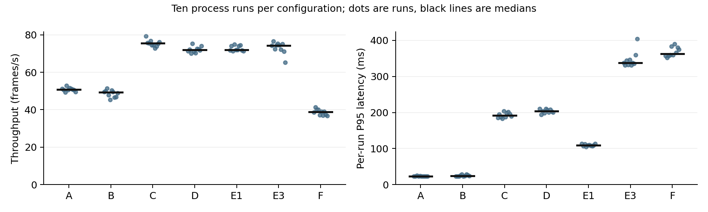
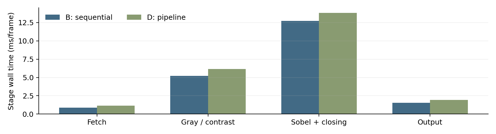

# CPU edge preprocessing:
Review 2 evaluation draft

Sequential and four-worker pipelined implementations on selected UFPR-ALPR images. Prepared for faculty discussion from executed programs and retained measurements, 2 October 2026.

### Main finding

The pooled pipeline D improved throughput over the pooled sequential baseline B on this workload: the geometric mean of paired FPS ratios was 1.482×, with a 95% bootstrap interval of 1.437–1.526. This result concerns execution organization for an identical deterministic preprocessor; it is not recognition accuracy or a trained-model comparison.

| Primary metric | B: sequential | D: pipeline |
| --- | --- | --- |
| Median throughput | 49.24 FPS | 71.92 FPS |
| Median per-run P95 latency | 23.86 ms | 203.31 ms |
| Median peak process RSS | 19.55 MiB | 339.78 MiB |
| Median process CPU use | 99.9% | 166.9% |
| Timed frame-array allocations / run | 0 | 0 |

The speedup has a cost: substantially greater frame latency and retained memory. Pooling reduced the instrumented allocation count but was slower in both measured allocation comparisons. Larger queues did not show a resolved throughput improvement. These adverse and inconclusive findings are part of the result.

Scope: 18 distinct full-resolution images were executed for initialization; the timed studies replay six selected test images from three tracks. The installed Drive inventory contains 4,500 images, but the full collection and the Windows target have not been executed here. No learned model was fitted.

## 1. Objectives and contributions

The question is whether a bounded four-stage CPU pipeline can increase completed-frame throughput while preserving the same edge-preprocessing output, and whether allocation, queue size and traversal choices justify their latency and memory costs.

| Objective / question | Program evidence | What can be concluded |
| --- | --- | --- |
| Numerical equivalence | Independent small-image reference tests; 18 full-size B/D byte comparisons; timed fingerprints | The tested outputs agree. This does not prove universal correctness. |
| Concurrency benefit | Primary D/B, same kernels and pooled allocation; ten paired blocks | Conditional throughput, latency, CPU and memory tradeoff on the recorded setup. |
| Allocation policy | B/A and D/C; 3N versus zero timed frame-array allocation calls | Allocation churn is removed; speed benefit must be measured and was not observed here. |
| Queue sizing | E1/D/E3: capacities 2/5/10; 34 slots fixed | Backlog and latency effects; a larger queue is not a faster edge worker. |
| Traversal choice | D/F: row versus column loops | Observed traversal effect; cache-miss attribution remains unmeasured. |
| Thread and ownership behavior | Worker IDs, frame intervals, slot reuse and bounded-queue audit | Different frames overlap across four workers without observed overwrite/reordering. |
| Input-rate behavior | 30/60 FPS virtual source; scheduled-source delay and final admission lag | Finite replay overload behavior under a blocking, no-drop policy. |

### Contributions supported by this implementation

First, the project supplies controlled sequential and pipelined implementations of one explicitly specified preprocessing subset linked to the supplied paper and patent. Shared kernels prevent numerical drift; separate program directories and result paths preserve a clear baseline/proposed-work demonstration.

Second, it provides an ablation framework that isolates the main execution choices and retains raw per-frame, worker and queue records. Third, it adds reproducible dataset preparation, evidence checks and paired run-level analysis, including unfavorable results. These are engineering and evaluation contributions. Algorithmic novelty, state-of-the-art ALPR performance and a production deployment have not been established.

## 2. Source alignment, algorithm and architecture

| Source anchor | Implemented connection | Explicit limit |
| --- | --- | --- |
| Chen et al. (2024), §4.4.1–4.4.2, printed p.1269 / PDF p.5 | Sobel, binary threshold and morphological closing | The attachment is a Procedia conference paper. Numerical constants here are project choices. |
| US6553131B1, Fig.1 block 16; description cols.4–5 | Vertical-edge extraction | The patent does not specify Sobel. Saliency, localization and recognition are not implemented. |

For RGB8, Y = floor((299R + 587G + 114B + 500)/1000); contrast C = clamp(floor((5Y + 2)/4) − 32, 0, 255). Apply the 3×3 Gx kernel [−1,0,1; −2,0,2; −1,0,1]. Set a binary pixel to 255 when |Gx| ≥ 80, otherwise zero. Closing is one full 3×3 dilation followed by erosion. Sobel borders and out-of-image morphology samples are zero. The profile is chen-patent-edge-subset-v1.

The threshold, affine constants, Gx-only choice, structuring element and border behavior are disclosed choices, not recovered original source code. This is a preprocessor, with no plate candidate detector, segmentation, classifier, OCR or learned parameters. Ground-truth boxes are used only for post-run inspection.

| Stage | Work / ownership |
| --- | --- |
| 1 • Fetch | Read/copy RGB into an owned slot; dynamic arrays, if selected, are allocated here. |
| 2 • Gray / contrast | Write the one-channel grayscale/contrast array. |
| 3 • Edges | Write Sobel/threshold output; close it using consumed RGB storage as dilation scratch. |
| 4 • Output / recycle | Copy and fingerprint the edge map; free dynamic arrays if used; return slot ownership. |

Sequential execution completes all four stages for one frame before the next. The proposed program assigns one std::thread to each stage. Three bounded FIFO queues carry slot IDs; mutexes and condition variables block on full/empty queues. A free-slot pool returns buffers to Fetch. Threads overlap different frames; they do not divide one image into four tiles. No thread-to-core affinity is enforced.

With S slots, frame arrays plus the shared output buffer occupy at most (5S + 1)WH bytes. At 1920×1080 this is 11.9 MiB for B (S=1) and 338.2 MiB for D (S=34), excluding other process memory. Keeping 34 slots for every pipeline treatment avoids changing pool capacity with queue depth; it is an experimental control, not a claim that 34 is optimal.

## 3. Dataset and experimental methodology

| Official split | Installed PNG / TXT pairs | Executed initialization sample |
| --- | --- | --- |
| Training | 1,800 / 60 tracks | 6 images / 3 tracks |
| Validation | 900 / 30 tracks | 6 images / 3 tracks |
| Testing | 1,800 / 60 tracks | 6 images / 3 tracks |

All 150 Drive track folders were listed. Only the selected 18 images were downloaded and decoded. Selection used frames 01 and 30 from the first, middle and last sorted track in each split. The test tracks are 0091, 0121 and 0150. This is a deterministic convenience sample, not a random or representative estimate over all vehicles.

Preparation preserves 1920×1080 resolution and the official split. PNG decoding to RGB occurs before timing; no resizing, cropping, augmentation or random resplitting occurs. Source and annotation SHA-256 values and replay manifests are retained. The “training” split supports initialization/pilots; the fixed operators have no fit step. No training loss, epochs or model weights exist.

| Study | Design |
| --- | --- |
| Primary ablation | 7 configurations × 10 randomized complete blocks; 600 frames/run; 60-frame separate-process warmup; unpaced file input; 70 runs. |
| Paced control | B, D, E1, E3 × 30/60 FPS × 3 blocks; 180 frames/run; 30-frame warmup; 24 runs. Exploratory duration. |
| RAM control | B and D × 5 blocks; 600 frames/run; 60-frame warmup; 10 runs. Preload excluded from timing. |
| Environment | Shared Linux x86-64; AMD EPYC 9V74 reported; 9 eligible logical CPUs; cgroup quota 8 CPU-equivalents; 8 GiB memory limit. GCC 13.3.0, C++20, -O3 -DNDEBUG -pthread. |
| Frozen controls | Source profile; threshold 80; identical input/order; capture=0; pipeline slots=34; randomized seed 260826. Numerical C++ code and binaries unchanged throughout. |

The timer includes frame read/copy, kernels, dynamic allocation/free, output copy/fingerprints, instrumentation, queue waits, fill/drain and scheduling. It excludes setup, PNG decoding, CSV/JSON writing and display. File mode can use the OS page cache; it is not a cold-disk benchmark. Warmup is a separate process and does not pre-touch the measured process’s pool.

Each process run is one observation. The paired estimate is exp(mean(log(FPS_candidate / FPS_baseline))) across blocks; a deterministic 10,000-resample bootstrap supplies its 95% interval. It is not the ratio of the displayed FPS medians. D/B is primary; secondary intervals are exploratory and unadjusted for multiple comparisons. Shared-machine disturbances and dataset selection are not captured by these intervals.

## 4. Main comparison and ablation results

All values below are medians across ten process runs. Latency columns are medians of per-run percentiles, not percentiles pooled across all frames. CPU 100% denotes one CPU-equivalent second per wall second. Peak RSS covers the process lifetime, including setup.

| ID | Allocation / traversal / queue | FPS | P95 ms | P99 ms | RSS MiB |
| --- | --- | --- | --- | --- | --- |
| A | dynamic / row / none | 50.72 | 23.18 | 27.83 | 19.6 |
| B | pool / row / none | 49.24 | 23.86 | 30.03 | 19.6 |
| C | dynamic / row / 5 | 75.42 | 192.39 | 209.61 | 142.1 |
| D | pool / row / 5 | 71.92 | 203.31 | 214.97 | 339.8 |
| E1 | pool / row / 2 | 72.02 | 109.15 | 119.75 | 339.8 |
| E3 | pool / row / 10 | 74.33 | 337.69 | 351.07 | 339.8 |
| F | pool / column / 5 | 38.80 | 362.96 | 401.10 | 339.8 |

### Paired throughput ratios

| Ratio | Effect examined | Estimate | 95% interval | Direction |
| --- | --- | --- | --- | --- |
| B/A | Sequential pooling | 0.957 | 0.930–0.985 | Below 1 |
| C/A | Dynamic pipeline | 1.484 | 1.459–1.510 | Above 1 |
| D/B | Primary pipeline | 1.482 | 1.437–1.526 | Above 1 |
| D/C | Pipeline pooling | 0.955 | 0.938–0.971 | Below 1 |
| D/E1 | Queue 2 → 5 | 0.990 | 0.980–1.002 | Crosses 1 |
| E3/D | Queue 5 → 10 | 1.013 | 0.977–1.042 | Crosses 1 |
| D/F | Column → row | 1.867 | 1.818–1.918 | Above 1 |
| D/A | Combined change | 1.418 | 1.399–1.438 | Above 1 |

D/E2 is one treatment, not two independent samples. D/B supports the preselected throughput hypothesis on this machine/sample. D/A bundles allocation and scheduling. B/A and D/C are below one: the expected speed benefit of buffer pooling is contradicted by these measurements, despite reducing timed large-array allocations from 1,800 to zero per 600-frame run.

Neither queue-depth comparison resolves a throughput direction at this precision. E1’s median P95 is 109.2 ms, D’s 203.3 ms and E3’s 337.7 ms. Queue depth 2 is therefore a candidate when latency matters on this workload; a universal optimum has not been demonstrated. F is slower than B even though it is pipelined, showing that parallel organization alone does not ensure a faster program.

## 5. Stage balance and architecture interpretation

B’s first-order stage-balance estimate is sum(t_i)/max(t_i) = 1.599×. The measured paired D/B ratio is 1.482×. The edge stage dominates: 12.74 ms/frame in B and 13.84 ms/frame in D. Four workers do not imply fourfold throughput when most work remains in one stage.

| D worker | Median CPU % | Median CV wait % | Interpretation |
| --- | --- | --- | --- |
| 1 | 8.4 | 89.8 | Mostly waits to hand off to Gray |
| 2 | 44.4 | 54.8 | Often waits to hand off to Edges |
| 3 | 99.8 | 0.1 | Dominant active stage |
| 4 | 14.1 | 86.1 | Mostly waits for edge output |

| D queue | Capacity | Median time-weighted depth | Maximum high-water mark |
| --- | --- | --- | --- |
| Q1 | 5 | 4.916 | 5 |
| Q2 | 5 | 4.947 | 5 |
| Q3 | 5 | 0.004 | 1 |

The near-full upstream queues and nearly empty downstream queue are consistent with the edge stage being the bottleneck. Larger buffers can store more waiting work but do not reduce its service demand. The theory assumes fixed service times and no resource contention; pipeline stage costs differ in practice, so the sum/max estimate is conditional, not a guaranteed speedup.

Pooling removes three frame-array allocation calls per frame, but allocator reuse, first-touch faults, retained working set, scheduling and memory-system behavior may affect time. This experiment does not identify which mechanism caused the slowdown. Likewise, row traversal is faster than column traversal here, but no measured cache-miss count or bandwidth result establishes the cause.

The recorded timeline shows one sequential worker identity versus four pipeline identities, stage overlap across different frames, and safe slot reuse in the tested runs. Wall-interval overlap includes preemption. Worker CPU time supports concurrent resource use; the demo does not expose per-core instruction execution.

## 6. Paced input and RAM controls

The paced control uses a virtual source release time i/rate. “Admitted P95” starts when the program obtains a slot; “Source P95” starts at that virtual release. The latter reveals upstream delay that admitted-frame latency can hide. Results are medians of three 180-frame runs per cell.

| Input FPS | Config | Output FPS | Admitted P95 ms | Source P95 ms | Final lag ms |
| --- | --- | --- | --- | --- | --- |
| 30 | B | 30.05 | 25.33 | 25.48 | 0.10 |
| 30 | D | 30.06 | 36.79 | 36.90 | 0.12 |
| 30 | E1 | 30.05 | 37.47 | 37.59 | 0.10 |
| 30 | E3 | 30.07 | 38.40 | 38.77 | 0.10 |
| 60 | B | 43.89 | 25.73 | 1063.71 | 1095.27 |
| 60 | D | 59.89 | 58.16 | 60.47 | 0.14 |
| 60 | E1 | 59.89 | 36.51 | 36.64 | 0.09 |
| 60 | E3 | 59.88 | 57.66 | 61.67 | 0.11 |

At 30 FPS, all treatments remain close to the requested rate over this short replay. At 60 FPS, B falls behind: median output is 43.89 FPS and final admission lag is 1,095.27 ms. D completes about 59.89 FPS with 0.14 ms median final lag, although transient source delay still reaches a much larger P95. A small final lag is not a maximum-latency guarantee.

All frames are preserved by blocking. Zero drops are a policy consequence, not evidence of lossless real-camera service. The 60 FPS runs last about 3–4 seconds, below the runner’s preferred five-second minimum; they are exploratory overload demonstrations. Slightly more than 30 output FPS can occur because frame 0 is released at time zero and elapsed time includes a finite last-frame drain.

### RAM input: supporting primary-pair check

| Config | Median FPS | Median P95 ms | Peak RSS MiB |
| --- | --- | --- | --- |
| B | 49.39 | 23.90 | 49.28 |
| D | 71.67 | 202.91 | 375.40 |

Across five RAM blocks, D/B is 1.446× (95% interval 1.410–1.484). This supports the persistence of the pipeline advantage when timed file reads are removed. Preload and allocation occur outside timing, while input copies remain. RAM and file studies were separate experiments, so their absolute difference is descriptive, not a paired estimate of storage cost.

## 7. Audit, limitations and remaining validation

The audit passed all 104 timed runs and 52,320 replay frames. It checks successful completion, planned block/configuration coverage, numerical settings, input dimensions/count, source order, stage order, slot reuse, worker identities, allocation accounting, queue bounds, FPS arithmetic and every frame’s fingerprint. No timed run was removed.

Every initialization image has matching complete B/D grayscale and edge captures. Independent scalar small-image references reduce the risk of a shared implementation error. Timed sum/weighted-sum fingerprints are non-cryptographic and can collide; they are a regression signal, not a collision-free proof. Dataset/binary hashes, compiler settings and raw measurements are retained.

| Limitation | Consequence / required next evidence |
| --- | --- |
| Six distinct test images | Repeated timing does not increase scene diversity. Execute the full official test split, retain tracks, and report image/camera/vehicle coverage. |
| Shared Linux host | Results do not predict the student’s Windows laptop. Rebuild with UCRT64 and repeat the fixed protocol under recorded power/cooling/background conditions. |
| Predecoded file/RAM replay | PNG/video decode, capture, network and GUI costs are excluded. Add end-to-end measurement before an application throughput claim. |
| Fixed edge operators | No fitted estimator, detector or OCR exists. Accuracy, IoU, precision/recall, confusion matrices and training curves are unavailable. |
| Limited controls | Only queue depths 2/5/10 and row/column traversal were varied. Threshold, resolution, affinity, pool size and worker topology were not swept. |
| Unprofiled mechanisms | No IPC, cycles, cache misses, bandwidth, context switches or energy counters. CV waits are partial synchronization measurements. |
| Short paced study / finite stream | No real-time deadline, live-camera drop model or long-run stability proof. Run longer paced trials and define an application latency budget. |
| Statistical scope | Ten primary blocks capture observed run variation; secondary tests are exploratory. Intervals omit dataset uncertainty and systematic shared-host effects. |

The source paper describes a fuller recognition system, and the patent includes localization and classification. The program implements a documented subset. Recognition figures from those sources must not be copied into this project’s results. A professor-facing claim of full ALPR reproduction or successful “training” would be unsupported.

## 8. Review 2 discussion and next demonstration

### Suggested draft conclusion

This work implemented a deterministic CPU edge-preprocessing workload using sequential controls and a four-stage bounded pipeline. The selected UFPR-ALPR outputs were preserved in the tested executions. On the recorded Linux sample, the primary pooled pipeline achieved a paired throughput gain of 48.2%, while P95 admitted-frame latency and peak process memory increased substantially. The edge stage limited scaling, consistent with the conditional stage-balance model.

The ablations did not validate a universal speed benefit from buffer pooling or larger queues. Pooling eliminated timed frame-array allocations but regressed in throughput; queue-depth changes left throughput direction unresolved and increased waiting latency. Row traversal outperformed column traversal, while the hardware cause remains unprofiled. These results justify a measured architecture tradeoff, not an unconditional optimization claim.

Review 2 can therefore present a completed implementation, source traceability, real-data initialization, measured concurrency and an auditable sample evaluation. Completion of the full-dataset Windows study remains the next validation step. Recognition functionality and model training require separately specified components and evaluation criteria.

### Demonstration sequence

| Step | What to show |
| --- | --- |
| 1 • Build and verify | MSYS2 UCRT64: build both programs; run scripts/check.py. Show the successful independent correctness report. |
| 2 • Initialize real data | Use scripts/initialize.py with the actual installed dataset path. Show separate baseline/pipeline outputs.html pages and the byte-equality comparison. |
| 3 • Explain concurrency | Run scripts/demo.py; select A/B/D and inspect recorded worker IDs, stage intervals and slot reuse. Explain ground-truth crops are not detections. |
| 4 • Present performance | Use retained repeated-study results, not captured-demo FPS. Show D/B and its interval, latency/memory costs, then adverse/inconclusive ablations. |
| 5 • Expose audit and limits | Run scripts/audit_evaluation.py on the experiment. Show raw frame/worker/queue records and state remaining Windows/full-dataset work. |

Full commands, directory navigation, dependency setup and output paths are in docs/MSYS_UFPR_GUIDE.md. The project ZIP includes reproducible source and measured logs; the full dataset, decoded replays, native binaries and large initialization captures are omitted. Two captured demo frames remain available offline. Recreate those outputs using the installed dataset. The actual-output contact sheet is in evidence/actual_output_contact_sheet.png.

### Source and evidence references

[1] H. Chen, X. Shi, M. Liu, C. Chen. A Chinese License Plate Recognition System based on OpenCV for complex environments. Procedia Computer Science 243 (2024), 1265–1272. DOI: 10.1016/j.procs.2024.09.149. Attached PDF, §4.4, p.1269.

[2] C. Neubauer and J.-K. Tyan. License plate recognition with an intelligent camera. US6553131B1, 22 April 2003. Attached PDF, Fig.1 block 16 and description cols.4–5.

[3] Installed UFPR-ALPR Drive inventory and selected-file provenance: data/drive_inventory.json and data/prepared/drive_init/*.epraw.json. [4] Executed evidence: results/review2_evaluation, review2_paced and review2_ram; experiment.json resolves every raw run. Detailed source boundaries: docs/SOURCE_ALIGNMENT.md.

